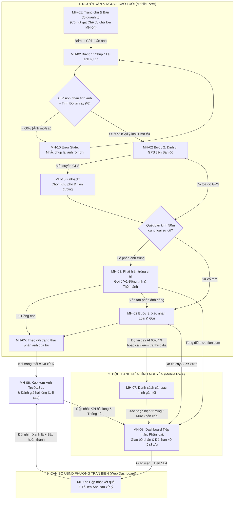

# TÀI LIỆU ĐẶC TẢ SƠ ĐỒ LUỒNG & GIAO DIỆN CHI TIẾT (ĐỀ 2)
**Dự án:** TrấnBiên Trực Tuyến – Phản ánh Hiện trường & Điều phối Đô thị Minh bạch  
**Mục đích:** Tài liệu chuẩn hóa luồng nghiệp vụ, cấu trúc dữ liệu mẫu và chi tiết 10 màn hình để dựng **Prototype bấm được** & xuất **Bản thiết kế PDF nộp bài**.

---

## 1. SƠ ĐỒ LUỒNG TỔNG THỂ (END-TO-END USER FLOW)

---

## 2. QUY TẮC THIẾT KẾ HỆ THỐNG (DESIGN SYSTEM)

### 2.1. Bảng màu ngữ nghĩa (Semantic Colors – Chuẩn tương phản WCAG AA/AAA)
- **Màu chủ đạo (Civic Trust Blue):** `#0F52BA` / `#1D4ED8` – Thể hiện sự tin cậy, minh bạch của chính quyền số.
- **Trạng thái Khẩn cấp / Mới tiếp nhận (Đỏ):** `#DC2626` (Nền nhạt `#FEF2F2`) – Ghim bản đồ sự cố chưa xử lý.
- **Trạng thái Đang xử lý / Cần xác minh (Cam/Vàng đậm):** `#D97706` (Nền nhạt `#FFFBEB`) – Ghim sự cố đang thi công hoặc AI tin cậy trung bình.
- **Trạng thái Đã xử lý xong / An toàn (Xanh lá):** `#16A34A` (Nền nhạt `#F0FDF4`) – Ghim sự cố đã có ảnh nghiệm thu.
- **Điểm nhấn Đoàn Thanh niên (Xanh Thanh niên):** `#0284C7` – Huy hiệu *"Đoàn viên đã xác minh tại chỗ"*.

### 2.2. Quy chuẩn Chữ & Kích thước nút bấm (Mobile Ergonomics)
- **Chế độ Tiêu chuẩn:** Font `Be Vietnam Pro` / `Inter`; cỡ chữ nội dung `15px–16px`, tiêu đề `20px–24px`, chiều cao nút tối thiểu `48px`.
- **Chế độ Người cao tuổi (Senior Mode – MH-04):** Bật bằng 1 nút gạt trên Header $\rightarrow$ Phóng chữ lên `19px–22px`, tiêu đề `26px–28px`, chiều cao nút bấm `64px–72px`, viền đậm `2px`, ẩn bản đồ nhiều chi tiết phức tạp thay bằng 3 thẻ hành động cực lớn.

---

## 3. ĐẶC TẢ CHI TIẾT 10 MÀN HÌNH (DÙNG CHO CẢ PROTOTYPE & BẢN PDF NỘP BÀI)

### MH-01: Trang chủ & Bản đồ các phản ánh quanh tôi *(Bắt buộc #3)*
- **Khung thiết kế:** Mobile (`390 x 844 px`).
- **Thành phần chính:**
  1. **Top Bar:** Logo *TrấnBiên Trực Tuyến* + Vị trí hiện tại (*KP.3, P. Trấn Biên*) + **Nút gạt `Chữ lớn` (Senior Mode)**.
  2. **Thanh tóm tắt minh bạch Phường Trấn Biên (Tháng 11/2026):** `64 Phản ánh` • `47 Đã xong (73,4%)` • `TB 3,2 ngày`.
  3. **Bộ lọc Chip ngang:** `Tất cả (64)` | `💡 Đèn đường (18)` | `🌊 Ngập nước (15)` | `🗑️ Rác thải (21)` | `🚧 Mặt đường (10)`.
  4. **Bản đồ tương tác quanh tôi:** Hiển thị vị trí của tôi (chấm xanh dương) và các ghim sự cố màu **Đỏ / Vàng / Xanh lá** trong bán kính 1km. Bấm vào 1 ghim hiện thẻ tóm tắt dưới đáy (ảnh nhỏ, tên đường, trạng thái, khoảng cách `120m`).
  5. **Nút hành động chính (FAB lớn chính giữa Bottom Nav):** **`📷 Gửi phản ánh (3 bước)`** + Thanh điều hướng đáy: `Quanh tôi` | `Gửi nhanh` | `Của tôi (2)` | `Vai trò (Demo)`.

### MH-02: Gửi phản ánh nhanh trong 03 bước & AI nhận diện ảnh *(Bắt buộc #1 + Điểm cộng AI)*
- **Khung thiết kế:** Mobile (`390 x 844 px`).
- **Thanh tiến trình 3 bước rõ ràng ở đầu trang:** `[1. Chụp ảnh] ──► [2. Vị trí] ──► [3. Chọn loại]`
- **Chi tiết hiển thị trên màn hình:**
  - **Khung Bước 1 (Ảnh hiện trường):** Ảnh chụp ổ gà đọng nước trên đường Hưng Đạo Vương.
  - **Hộp kết quả AI Vision (Điểm nhấn sáng tạo):**
    - Huy hiệu xanh: `✨ AI Gợi ý tự động` | **`Độ tin cậy: 92% (Cao)`** (thanh tiến trình xanh 92%).
    - Dấu hiệu AI phát hiện: `[Mặt đường nứt vỡ]` `[Đọng nước vũng lớn]` `[Gần vạch qua đường]`.
    - Mô tả AI điền sẵn (cho phép sửa hoặc bấm mic nói thêm): *"Ổ gà sâu đọng nước sau mưa gây nguy hiểm cho xe máy trước số 142 Hưng Đạo Vương."*
  - **Khung Bước 2 (Vị trí trên bản đồ mini):** Tọa độ tự động `142 Đường Hưng Đạo Vương, KP.2, P. Trấn Biên` (sai số GPS `±8m`, nút *Chỉnh ghim*).
  - **Khung Bước 3 (Chọn loại sự cố – 4 ô vuông lớn, ô Mặt đường đã được AI khoanh chọn sẵn):**
    - `🚧 Mặt đường / Ổ gà (AI chọn)` | `💡 Đèn đường hỏng` | `🌊 Ngập nước` | `🗑️ Rác thải tự phát`.
  - **Nút đáy lớn:** **`Gửi phản ánh ngay →`**.

### MH-03: Phát hiện & Gộp phản ánh trùng vị trí bán kính 50m *(Điểm cộng Gộp trùng)*
- **Khung thiết kế:** Mobile (`390 x 844 px` – Bottom Sheet nổi trên nền bước gửi).
- **Nội dung:**
  - Biểu tượng radar thông minh: **"Phát hiện phản ánh trùng vị trí (cách 18m)!"**
  - Thẻ sự cố hiện hữu: Mã `#TB-1162` – *Ổ gà lớn trước 140 Hưng Đạo Vương* • Đã có **03 người dân** báo • Trạng thái: *Đoàn viên đã xác minh*.
  - Giải thích ngắn gọn: *"Gộp phản ánh giúp Phường ưu tiên xử lý điểm nóng này nhanh hơn thay vì tách nhiều hồ sơ lẻ."*
  - **2 Nút hành động rõ ràng:**
    1. Nút chính (màu xanh đậm): **`👍 +1 Đồng tình & Đính kèm thêm ảnh của tôi`** *(Khuyên dùng)*
    2. Nút phụ (viền mảnh): `Đây là sự cố khác – Vẫn gửi phản ánh mới`

### MH-04: Chế độ Người cao tuổi – Chữ lớn & Tương phản cao *(Điểm cộng + Tiêu chí UX 30đ)*
- **Khung thiết kế:** Mobile (`390 x 844 px`).
- **Nội dung:** Khi bật nút **`Chữ lớn: BẬT`**, toàn bộ giao diện chuyển sang nền trắng tinh, chữ đen đậm cỡ `20px–26px`, lược bỏ các biểu đồ rối mắt, chỉ giữ **3 Nút bấm khổng lồ xếp dọc** chiếm trọn màn hình dễ chạm bằng cả bàn tay:
  1. Nút Đỏ cam lớn: **`1. CHỤP ẢNH BÁO SỰ CỐ`** *(Đèn hỏng, ổ gà, rác, ngập nước)*
  2. Nút Xanh dương lớn: **`2. XEM KẾT QUẢ TÔI ĐÃ BÁO (02)`** *(1 việc Phường đã sửa xong!)*
  3. Nút Xanh lá lớn: **`3. NHỜ ĐOÀN VIÊN KHU PHỐ HỖ TRỢ`** *(Gọi hoặc nhắn Đội tình nguyện)*

### MH-05: Theo dõi trạng thái phản ánh của tôi *(Bắt buộc #2)*
- **Khung thiết kế:** Mobile (`390 x 844 px`).
- **Nội dung:**
  - Bộ lọc tab: `Tất cả (3)` | `Đang xử lý (1)` | `Đã hoàn thành (2)`.
  - **Thẻ chi tiết mở rộng (#TB-1158 – Đèn đường tắt tối góc hẻm 45 Nguyễn Ái Quốc):**
    - Huy hiệu: `Đang xử lý` • `Hạn cam kết (SLA): 17:00 hôm nay (Còn 7 giờ)`.
    - **Timeline 4 bước dọc:**
      - ✅ `08:15 23/11` – **Đã tiếp nhận:** Hệ thống ghi nhận (Gộp từ 2 phản ánh người dân).
      - ✅ `09:40 23/11` – **Đoàn viên xác minh:** Bí thư Chi đoàn KP.4 xác nhận bóng cao áp cháy, hẻm đông học sinh đi học tối.
      - 🔄 `14:00 23/11` – **Đã giao xử lý:** UBND Phường giao *Đội Quản lý Chiếu sáng Đô thị*.
      - ⭕ `Dự kiến 24/11` – **Hoàn thành & Mời đánh giá.**
  - **Thẻ đã xong (#TB-1149 – Rác thải tự phát đường Cách Mạng Tháng 8):** Huy hiệu xanh `Đã xử lý xong sau 1,8 ngày` + Nút nổi **`Xem ảnh Sau xử lý & Đánh giá ★`**.

### MH-06: Đối chiếu ảnh Trước/Sau & Đánh giá mức độ hài lòng *(Bắt buộc #6)*
- **Khung thiết kế:** Mobile (`390 x 844 px`).
- **Nội dung:**
  - Tiêu đề: **Kết quả xử lý sự cố `#TB-1149`** *(Xử lý trong 1,8 ngày – Nhanh hơn TB phường 1,4 ngày)*.
  - **Khung kéo trượt trực quan (Before / After Image Comparison):** Bên trái nhãn Đỏ `TRƯỚC (21/11 - Rác tràn vỉa hè)` $\leftrightarrow$ Thanh kéo giữa $\leftrightarrow$ Bên phải nhãn Xanh `SAU (23/11 - Đã thu dọn sạch & đặt biển cấm)`.
  - Ghi chú của đơn vị xử lý: *"Tổ Môi trường số 2 đã thu gom 450kg rác tồn đọng lúc 06:30 sáng và phối hợp KP.1 nhắc nhở hộ dân."*
  - **Khu vực Đánh giá của người dân:**
    - 5 Ngôi sao lớn tương tác (`★★★★★` – *Rất hài lòng*).
    - Chip chọn nhanh cảm nhận: `[⚡ Xử lý nhanh]` `[✨ Dọn rất sạch]` `[👍 Cán bộ nhiệt tình]` `[⚠️ Lo ngại tái phát]`.
    - Ô nhập góp ý thêm + Nút **`Gửi đánh giá công khai`**.

### MH-07: Đội Thanh niên Tình nguyện – Xác minh tại chỗ & Báo hộ *(Vai trò #3 của đề)*
- **Khung thiết kế:** Mobile (`390 x 844 px`).
- **Nội dung:**
  - Header Đoàn viên: *Nguyễn Minh Khoa – Đội TNTN Phường Trấn Biên (Đã hỗ trợ xác minh: 14 vụ)*.
  - **Danh sách sự cố cần xác minh gần vị trí (< 500m):**
    - Thẻ `#TB-1164` *(Cách 150m – Ngập nước cống hẻm 88 Hà Huy Tập)*: Lý do cần xác minh: **`⚠️ Độ tin cậy AI: 68% (Trung bình - Ảnh chụp ban đêm hơi tối)`**.
    - Hành động 1 chạm tại hiện trường: Chụp bổ sung ảnh rõ nét + Chọn mức độ thực tế (`Khẩn cấp - Gần cổng trường Tiểu học Trấn Biên` / `Bình thường` / `Báo nhầm - Không có sự cố`) + Bấm **`Xác nhận gửi UBND Phường`**.
  - Nút phụ nổi bật dưới đáy: **`🤝 Chế độ Gửi phản ánh hộ Cô/Chú cao tuổi`**.

### MH-08: Dashboard Cán bộ UBND Phường – Tiếp nhận, Phân loại & Giao hạn xử lý *(Bắt buộc #4)*
- **Khung thiết kế:** Desktop / Tablet ngang (`1440 x 900 px`).
- **Nội dung (khớp chuẩn 100% số liệu đề bài):**
  - **4 Thẻ KPI hàng đầu (Phường Trấn Biên – Tháng 11/2026):**
    1. **Tổng phản ánh:** `64` *(🗑️ Rác thải: 21 | 💡 Đèn đường: 18 | 🌊 Ngập nước: 15 | 🚧 Mặt đường: 10)*
    2. **Đã xử lý xong:** `47 / 64` *(Đạt tỷ lệ **73,4%**)*
    3. **Thời gian xử lý TB:** `3,2 ngày` *(Giảm 1,5 ngày nhờ AI & Đoàn viên lọc trước)*
    4. **Mức độ hài lòng dân:** `4,7 / 5,0 ★` *(94% đánh giá tích cực)*
  - **Bố cục chính chia 2 cột thông minh:**
    - *Cột trái (65% – Danh sách điều phối ưu tiên):* Bảng lọc theo Trạng thái / Loại / Cụm gộp trùng. Dòng đầu nổi bật `#TB-1162` có nhãn **`🔥 Cụm 4 người báo`** + **`✓ Đoàn viên đã xác minh`** + **`AI: 92%`**.
    - *Cột phải (35% – Panel Phân loại & Giao việc nhanh cho đơn đang chọn):*
      - Xem ảnh hiện trường, vị trí trên bản đồ thu nhỏ, kết quả AI + ghi chú của Đoàn viên.
      - Dropdown **Phân loại chuẩn:** `Hư hỏng mặt đường (Ổ gà)`.
      - Dropdown **Giao bộ phận chuyên môn:** `Ban Quản lý Dự án & Duy tu Giao thông` / `Công ty CP Môi trường Sonadezi` / `Đội Điện chiếu sáng` / `UBND & Công an Khu phố`.
      - Chọn **Hạn xử lý (SLA):** `24 giờ (Khẩn cấp)` | `72 giờ (Tiêu chuẩn)` | Chọn ngày cụ thể (`26/11/2026 - 17:00`).
      - Nút hành động: **`Phê duyệt & Giao xử lý ngay`**.

### MH-09: Cập nhật kết quả kèm Ảnh sau xử lý *(Bắt buộc #5)*
- **Khung thiết kế:** Giao diện Modal/Drawer trên Dashboard Cán bộ hoặc Mobile của Đơn vị thi công (trình bày rõ cả khung form nghiệm thu).
- **Nội dung:**
  - Thông tin hồ sơ đang nghiệm thu: `#TB-1162` – *Vá ổ gà trước 140–142 Hưng Đạo Vương* (Đơn vị: *Tổ Duy tu Giao thông* • Còn trước hạn SLA `14 giờ`).
  - **Đối chiếu trực tiếp:** Khung trái hiện sẵn *Ảnh Trước xử lý (người dân gửi)* $\rightarrow$ Khung phải ô tải lên **`📷 Tải lên Ảnh SAU XỬ LÝ (Bắt buộc có GPS tại hiện trường)`**.
  - **AI Kiểm tra nghiệm thu tự động:** Huy hiệu xanh `✓ AI đối chiếu bối cảnh: Khớp vị trí (Độ tin cậy 95%) – Mặt đường đã được thảm nhựa phẳng`.
  - Ô nhập nội dung phản hồi công khai cho người dân + Nút **`Hoàn tất xử lý & Công khai kết quả cho người dân`**.

### MH-10: Xử lý Trường hợp Lỗi (Error States) & Trạng thái Trống (Empty States) *(Ăn trọn Tiêu chí 2 – 30đ)*
- **Khung thiết kế:** Trang tổng hợp 3 khung Mobile mini đặt cạnh nhau trực quan:
  1. **Error State 1 – Độ tin cậy AI thấp (`38%`) / Ảnh mờ nhòe:** Không cho gửi ảnh đen/mờ gây khó cho phường; hiện khung hướng dẫn vàng cam *"Ảnh hơi tối hoặc rung tay (Độ tin cậy AI: 38%). Bác vui lòng bật đèn flash hoặc đứng gần hơn một chút để chụp lại nhé!"* kèm nút `Chụp lại ngay`.
  2. **Error State 2 – Không lấy được định vị GPS:** Khi người dân tắt quyền vị trí hoặc đứng dưới mái tôn mất sóng $\rightarrow$ Hiện giao diện dự phòng mượt mà: *"Chưa bật định vị GPS – Chọn nhanh vị trí theo Khu phố & Tên đường"* (Dropdown chọn `Khu phố 1..6` + Gợi ý đường `Phạm Văn Thuận`, `Nguyễn Ái Quốc`, `Hưng Đạo Vương`, `30 Tháng 4` + ô nhập số nhà/mốc nhận biết).
  3. **Empty State – Khu vực an toàn không có sự cố:** Khi lọc bán kính 500m hoặc danh sách "Đang chờ xử lý của tôi" trống $\rightarrow$ Minh họa khu phố xanh sạch tại Trấn Biên kèm thông điệp tích cực: *"Khu phố quanh bạn hiện không có sự cố hạ tầng nào tồn đọng! Cảm ơn bà con đã chung tay giữ gìn đô thị văn minh."*

---

## 4. BỘ DỮ LIỆU MẪU CHUẨN HÓA (PHƯỜNG TRẤN BIÊN – THÁNG 11/2026)

| Mã đơn | Loại sự cố | Địa điểm (P. Trấn Biên) | Độ tin cậy AI | Số người gộp | Trạng thái | Bộ phận phụ trách | Thời gian / SLA |
| :--- | :--- | :--- | :---: | :---: | :--- | :--- | :--- |
| `#TB-1164` | 🌊 Ngập nước | Hẻm 88 Hà Huy Tập, KP.3 | **68%** *(Trung bình)* | 1 | **Chờ Đoàn viên xác minh** | Đội TNTN Khu phố 3 | Mới gửi 15 phút trước |
| `#TB-1162` | 🚧 Mặt đường | 142 Hưng Đạo Vương, KP.2 | **92%** *(Cao)* | **4 người** | **Mới tiếp nhận (Ưu tiên)** | Chờ cán bộ giao việc | Gợi ý SLA: 48 giờ |
| `#TB-1158` | 💡 Đèn đường | Hẻm 45 Nguyễn Ái Quốc, KP.4 | **96%** *(Cao)* | 2 người | **Đang xử lý** | Đội Điện chiếu sáng | Hạn: 17:00 24/11 |
| `#TB-1149` | 🗑️ Rác thải | Ngã ba Cách Mạng Tháng 8, KP.1 | **94%** *(Cao)* | 3 người | **Đã xử lý xong (5★)** | Xí nghiệp Môi trường | Xong sau **1,8 ngày** |
| `#TB-1141` | 💡 Đèn đường | Đường Võ Thị Sáu, KP.5 | **91%** *(Cao)* | 1 | **Đã xử lý xong (5★)** | Đội Điện chiếu sáng | Xong sau **2,5 ngày** |
| `#TB-1135` | 🌊 Ngập nước | Cống thoát đường 30/4, KP.2 | **89%** *(Cao)* | 5 người | **Đã xử lý xong (4★)** | Tổ Thoát nước Đô thị | Xong sau **4,1 ngày** |
