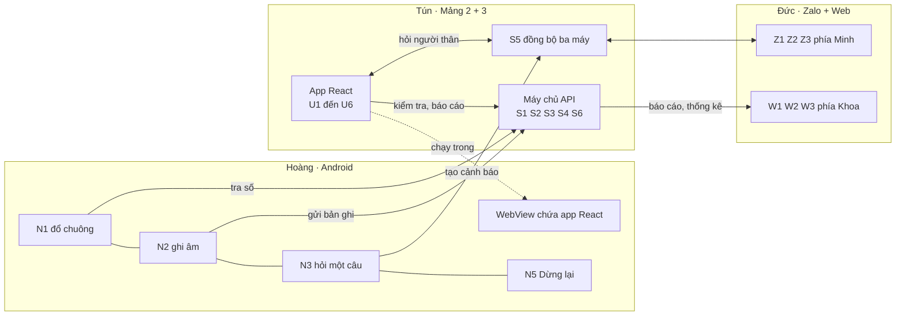

# Kế hoạch Mảng 2 (Máy chủ và AI) và Mảng 3 (Giao diện app)

Đội 18 · Lá chắn số · bản MVP 24 giờ. Mảng 1 và 4: Hoàng. Mảng 2 và 3: Tún. Mảng 5 và 6: Đức.

Mã đã có: máy chủ trong [`server/`](server/README.md), app React trong [`app/`](app/README.md). Đội hỏi BTC xem có được mang mã viết trước vào chung kết không; nếu không được thì chỉ dùng tài liệu này làm kế hoạch.

Mọi màn nhắc tới đều có trong `screens/` và bản mẫu https://la-chan-so-doi18.vercel.app. Làm đúng như thiết kế, không thêm màn mới.

---

## 1. Hai mảng này nối với cả đội ra sao



| Tún đưa cho | Thứ gì | Cần chốt trước giờ |
|---|---|---|
| Hoàng | API tra số nhanh cho N1; API phân tích bản ghi cho N2; API tạo cảnh báo cho N3, N5; app React để nhúng vào WebView | 1 (hợp đồng), 4 (API chạy trên mạng) |
| Đức | Sự kiện đồng bộ cho Z1, Z2; API báo cáo cho Z3; API báo cáo, kiểm duyệt, thống kê cho W1, W2; bộ thành phần React dùng chung | 1, 4 |

| Tún cần từ | Thứ gì |
|---|---|
| Hoàng | Cầu nối giữa WebView và Android (mục 4.4); danh sách kiểu lừa đảo khớp tên truyện (mục 2.4) |
| Đức | Xác nhận dạng sự kiện Minh gửi về (mục 2.2) |

---

## 2. Hợp đồng dữ liệu (cả đội chốt trong giờ đầu)

Tún mang bản nháp này ra họp. Tên trường viết tiếng Anh không dấu cho dễ code; chữ hiện trên màn viết tiếng Việt và do máy chủ trả về.

### 2.1 Kết quả phân tích: `AnalysisResult`

Dùng chung cho kiểm tra nhanh (A07a–d), phân tích tin nhắn (A05b), phân tích cuộc gọi (A04b).

| Trường | Kiểu | Ý nghĩa |
|---|---|---|
| `id` | chuỗi | mã lượt kiểm tra |
| `kind` | `phone` · `link` · `account` · `message` · `call` | loại đầu vào |
| `display` | chuỗi | giá trị hiện trên màn, đã che (ví dụ `1903 xxxx 5678`) |
| `level` | `danger` · `suspicious` · `safe` · `unknown` | 4 mức, xem bảng dưới |
| `reason` | `null` · `insufficient` · `otp` | `insufficient` mở E01d; `otp`: tin có mã xác thực, không gửi AI (cũng hiện ở E01d). Mất mạng thì app tự mở E01c |
| `scamType` | mã ở mục 2.4 hoặc `null` | để mở đúng truyện (H1) và gom thống kê (W1) |
| `scamLabel` | chuỗi | ví dụ "Giả danh công an" |
| `headline` | chuỗi | câu lớn dưới mức độ, ví dụ "14 người đã báo số này giả danh công an." |
| `note` | chuỗi hoặc `null` | dòng thứ hai, ví dụ "Điều đó không có nghĩa là an toàn." (A07c, A07d) |
| `why` | mảng chuỗi | mục "Vì sao?" |
| `todo` | mảng chuỗi | mục "Bạn nên làm gì" |
| `signs` | mảng `{text, quotes}` | dấu hiệu AI thấy; `quotes` là các đoạn nguyên văn trong `maskedText` để tô đỏ (A05b, A04b) |
| `maskedText` | chuỗi hoặc `null` | tin nhắn hoặc bản chép lời đã che |
| `reports` | `{count, last7d, lastAt, verified}` | số báo cáo đã duyệt còn hạn |
| `source` | `directory` · `community` · `heuristic` · `ai` · `fallback` | kết quả đến từ đâu |
| `confidence` | số 0–1 | độ tin cậy |

| `level` | Màn | Nhãn | Khi nào |
|---|---|---|---|
| `danger` | A07a | Nguy hiểm | Có báo cáo đã duyệt còn hạn, hoặc AI thấy rõ kịch bản lừa đảo |
| `suspicious` | A07b | Nghi ngờ | Đường dẫn có dấu hiệu giả (đuôi lạ, tên nhái, rút gọn, mới đăng ký), hoặc AI thấy dấu hiệu nhưng chưa chắc |
| `safe` | A07c | An toàn | **Chỉ khi khớp danh bạ trắng** (`source: directory`). AI không bao giờ được trả `safe` |
| `unknown` | A07d | Chưa có dữ liệu | Mọi trường hợp còn lại; kèm ba câu tự kiểm tra |

Ví dụ khớp màn A07a:

```json
{
  "id": "chk_01", "kind": "phone", "display": "0912 345 678",
  "level": "danger", "reason": null,
  "scamType": "gia_danh_cong_an", "scamLabel": "Giả danh công an",
  "headline": "14 người đã báo số này giả danh công an.",
  "why": ["14 báo cáo trong 7 ngày, gần nhất hôm qua", "Tự xưng cán bộ điều tra, đòi chuyển tiền", "Đội tình nguyện đã xác nhận"],
  "todo": ["Cúp máy, không gọi lại.", "Không chuyển tiền, không đọc mã xác thực (OTP)."],
  "note": null, "signs": [], "maskedText": null,
  "reports": {"count": 14, "last7d": 14, "lastAt": "2026-11-23T16:20:00+07:00", "verified": true},
  "source": "community", "confidence": 0.94
}
```

### 2.2 Sự kiện đồng bộ ba máy (S5)

Mỗi sự kiện có chung vỏ: `{type, room, at, from, data}`. Bản demo có hai phòng: `gia-dinh-hoa` (bà Hoa, Minh, Lan) và `tnv-tran-bien` (Khoa).

| `type` | Ai gửi | Ai nghe | `data` | Màn |
|---|---|---|---|---|
| `alert.created` | Android (N1, N2, N3) | Minh | `alertId, level, scamType, scamLabel, phoneDisplay, summaryMasked, asksMoney` | Z01a |
| `alert.timeline` | Android (N3, N5) | Minh | `alertId, time, text` (ví dụ "Mẹ mở ứng dụng ngân hàng. Lá chắn đã nhắc dừng.") | Z01b mục Diễn biến |
| `ask.sent` | app bà Hoa (U4) | Minh | `askId, to, text, alertId?` | A08a → Z01a |
| `ask.seen` | Minh | bà Hoa | `askId` | A08b "Minh đã xem" |
| `ask.reply` | Minh (Z2) | bà Hoa | `askId, preset, text` với `preset` là `dung_chuyen` hoặc `nguoi_quen` | Z01b → A08c, Z01c |
| `report.created` | máy chủ (S6) | Khoa | `reportId, status, scamType` | W02 tăng số ca |
| `report.updated` | máy chủ (S6) | Khoa | `reportId, status` | W02 |

Đường dự phòng khi WebSocket hỏng: gửi bằng `POST /api/events`, nhận bằng `GET /api/events?room=…&since=…` gọi mỗi 2 giây. Hai đường trả cùng một dạng sự kiện nên giao diện không phải sửa.

### 2.3 Báo cáo (S6): `Report`

| Trường | Ý nghĩa |
|---|---|
| `id`, `createdAt` | |
| `kind` | `call` · `message` · `link` · `account` |
| `target` | số, đường dẫn hoặc tài khoản (khi hiện cho người khác thì che bớt) |
| `story` | "Chuyện gì đã xảy ra?" (A09a), đã che trước khi lưu |
| `hasAudio` | người dùng chọn đính kèm bản ghi thì mới có; chỉ đội duyệt nghe được |
| `lostMoney` | Chưa · Rồi |
| `area` | khu phố, ví dụ "Khu phố 4" |
| `status` | `pending` → `ai_confirmed` · `ai_rejected` · `needs_review` → `confirmed` · `rejected`; `appealed` khi có khiếu nại |
| `ai` | `{scamType, scamLabel, confidence}` |
| `reporterCount` | số người đã báo cùng đối tượng ("Bạn là người thứ 15") |
| `verifiedAt`, `expiresAt` | nhãn chỉ có hiệu lực sau duyệt; `expiresAt = verifiedAt + 90 ngày` |

### 2.4 Mã kiểu lừa đảo (chốt cùng Hoàng để khớp tên truyện)

`duong_dan_gia` (Đường dẫn giả mạo) · `gia_danh_cong_an` (Giả danh công an) · `viec_nhe_luong_cao` (Việc nhẹ lương cao, tuyển cộng tác viên) · `nguoi_than_tai_nan` (Người thân gặp tai nạn) · `gia_dien_luc` (Giả nhân viên điện lực) · `qua_tri_an` (Quà tri ân) · `khac` (Khác).

---

## 3. Mảng 2: Máy chủ và AI

**Đề xuất:** Python FastAPI, SQLite cho báo cáo, WebSocket cho đồng bộ. Lý do: máy Tún đã có sẵn Python, và một máy chủ lo được cả API lẫn WebSocket. Đội chốt lại ở giờ đầu nếu muốn khác.

### 3.1 Danh sách API

| Đường dẫn | Tính năng | Ai gọi |
|---|---|---|
| `GET /api/lookup/phone/{so}` | S1 bản nhanh, không gọi AI, trả trong 300 ms | N1 lúc đổ chuông (A03a, A03b) |
| `POST /api/check` `{kind, value}` | S1 + S2 | U2 (A06a → A07a–d) |
| `POST /api/analyze/message` `{text}` | S2 + S4 | U3 (A06b → A05b), N4 |
| `POST /api/analyze/call` (tệp âm thanh) | S3 + S4 | N2 (A04b) |
| `POST /api/alerts` | tạo cảnh báo rồi phát `alert.created` | N1, N2, N3 |
| `WS /ws?room=…` · `POST /api/events` · `GET /api/events` | S5 | app, Android, Zalo, web |
| `POST /api/reports` · `GET /api/reports?status=` · `PATCH /api/reports/{id}` · `POST /api/reports/{id}/appeal` | S6 | U5, Z3, W2 |
| `GET /api/stats?month=2026-11` | S6 tổng hợp | W1 |
| `POST /api/demo/reset` | đưa dữ liệu về đầu kịch bản demo | cả đội trước mỗi lần diễn |
| `GET /api/health` | kiểm máy chủ còn sống | trước demo |

### 3.2 Cách quyết định mức (S1)

Làm theo đúng thứ tự, gặp điều kiện nào trước thì dừng:

1. Khớp danh bạ trắng (tổng đài đã xác thực, tên miền chính thức) → `safe`.
2. Có báo cáo đã duyệt còn hạn → `danger`, kèm số báo cáo và kiểu lừa đảo.
3. Đường dẫn: đuôi ít dùng (`.top`, `.xyz`, `.click`…), tên gần giống trang chính thức, liên kết rút gọn, tên miền mới đăng ký (bản demo dùng bảng tuổi giả lập) → `suspicious`, mỗi dấu hiệu thành một dòng "Vì sao?".
4. Tin nhắn: chuyển sang S2.
5. Còn lại → `unknown`.

Danh sách mẫu lấy từ `prototype/mock-data.js` (`DANGER_NUM`, `OFFICIAL_NUM`, `DANGER_LINK`, `SUSPECT_TLD`, `OFFICIAL_LINK`) để kết quả giống bản mẫu đã nộp.

### 3.3 Điểm trung gian gọi AI (S2)

- Khóa AI nằm ở máy chủ, đọc từ biến môi trường. Đội đang dùng Gemini với biến `GEMINI_API_KEYS` (xem `tools/gemini_stt_check.py`); dùng lại cho thống nhất.
- Bắt AI trả đúng JSON theo mục 2.1 (chế độ trả JSON có lược đồ). Máy chủ kiểm lại; sai dạng thì dùng kết quả dự phòng.
- Chờ AI tối đa khoảng 6 giây, quá thì dùng kết quả dự phòng.
- **Kết quả dự phòng:** bảng trả lời sẵn cho các mẫu demo (tin "việc nhẹ lương cao", tin "khóa trong 24h", "Alo, gọi lại anh nhé"), đánh `source: fallback`. Mất mạng hay hết lượt AI thì demo vẫn chạy.
- **Chặn trên máy chủ:** AI trả `safe` thì hạ thành `unknown`. Tin quá ngắn hoặc không có dấu hiệu thì trả `unknown` kèm `reason: insufficient` (E01d "AI không đoán bừa").
- Lời dặn cho AI (đã viết trong `server/lcs/ai.py`): chỉ phân tích dấu hiệu lừa đảo; trả `quotes` đúng nguyên văn; giải thích bằng lời dễ hiểu cho người lớn tuổi; không bao giờ khuyên chuyển tiền hay đọc mã xác thực.

### 3.4 Chép lời và phân tích cuộc gọi (S3)

Nhận tệp ghi âm từ N2, chép lời (Gemini nhận âm thanh trực tiếp), che bản chép lời qua S4, rồi phân tích như S2. Trả `maskedText` dạng từng lượt nói "Người gọi: …" để A04b hiện "Bản chép lời" và tô đỏ. **Không lưu tệp âm thanh**; chỉ giữ lại khi người dùng chọn đính kèm vào báo cáo (A09a).

### 3.5 Che dữ liệu riêng (S4)

- Trước khi gửi AI: thay số điện thoại, số tài khoản, số thẻ, số căn cước bằng nhãn `[SĐT]`, `[TK]`…; chữ hiện trên màn che kiểu `1903 xxxx 5678`.
- **Tin có mã OTP thì không gửi AI** (Android đã bỏ qua từ N4; máy chủ chặn thêm một lần).
- Không ghi nội dung tin nhắn, bản chép lời vào nhật ký máy chủ hay cơ sở dữ liệu. Chỉ lưu báo cáo người dùng tự gửi, và lưu bản đã che.

### 3.6 Đồng bộ ba máy (S5)

- Phòng giữ trong bộ nhớ, mỗi phòng nhớ khoảng 50 sự kiện gần nhất để máy vào lại không mất tin.
- Ghép đôi bà Hoa với Minh, Lan là dữ liệu mẫu cố định. Màn "Quét mã ghép đôi" (E01b) chỉ cần dẫn tới đó.
- `POST /api/demo/reset` xóa phòng và đưa báo cáo về số liệu ban đầu.

### 3.7 Báo cáo và kiểm duyệt (S6)

- SQLite; nạp sẵn 120 báo cáo giả lập khớp số trên W01 và W02: 42 đường dẫn giả, 30 giả danh công an, 24 việc nhẹ lương cao, 12 người thân tai nạn, 12 khác; 78 AI xác nhận, 18 AI loại, 24 chờ duyệt, 2 khiếu nại; 4 tuần 22, 27, 31, 40; 5 khu phố.
- Báo cáo mới: AI phân loại (S2). Đủ chắc thì `ai_confirmed` hoặc `ai_rejected`; chưa chắc thì `needs_review` và tới tay Khoa (W02).
- Nhãn hết hạn sau 90 ngày: tra số (bước 2 của S1) chỉ tính báo cáo đã duyệt và chưa hết hạn.
- Trả `reporterCount` và điểm đóng góp để A09c hiện "Bạn là người thứ 15", "+10 điểm".

---

## 4. Mảng 3: Giao diện app (React trong WebView)

**Đề xuất:** Vite + React, định tuyến kiểu `#/` cho chạy ổn trong WebView. Dùng nguyên `ds.css` (ở gốc `la-chan-so/`) làm CSS chung để giống thiết kế, không vẽ lại. Cần cài Node trên máy (hiện chưa có).

### 4.1 Bộ thành phần dùng chung (chia cho Đức dùng ở Zalo và web)

Tách từ `ds.css`, `icons.js` và các màn HTML: `Icon` (từ `icons.js`), `AppBar`, `TabBar` (Lá chắn · Kiểm tra · Học · Tôi), `Card`, `Button` (chính, phụ, nguy hiểm), `Segmented` (Số ĐT · Đường dẫn · Tài khoản · Tin nhắn), `LevelBanner` (4 mức), `ReasonList` (Vì sao?), `StepList` (Bạn nên làm gì, có số thứ tự), `SelfCheck` (ba câu tự kiểm tra), `Chip`, `Toast`. Chế độ chữ lớn là một lớp CSS bọc ngoài, không làm thành phần riêng.

### 4.2 Màn, dữ liệu và API

| Mã | Màn | Lấy dữ liệu từ | Ghi chú |
|---|---|---|---|
| U1 | A01a trang chủ đơn giản · A01b đầy đủ | hồ sơ mẫu; `GET /api/stats` cho "Kiểu lừa đảo mới ở khu vực bạn" | Đơn giản: chữ lớn, tối đa 3 lựa chọn, đọc to, chuyển động chậm (D04). "Nói với Lá chắn" gọi cầu nối Android |
| U2 | A06a → A07a, A07b, A07c, A07d | `POST /api/check` | Chọn màn theo `level`; "Từ nhật ký gọi" gọi cầu nối; "Vừa kiểm tra" lưu trên máy |
| U3 | A06b → A05b | `POST /api/analyze/message` | Tô đỏ từng `signs[].quotes` trong `maskedText`; "Báo cho cộng đồng" mở A09b |
| U4 | A08a → A08b → A08c | S5: gửi `ask.sent`, nghe `ask.seen`, `ask.reply` | A08c đọc to lời Minh (cầu nối hoặc giọng đọc của trình duyệt); "Đã chặn số" gọi cầu nối |
| U5 | A09a → A09b → A09c | `POST /api/reports` | A09c lấy `ai.scamLabel`, `confidence`, `reporterCount` từ phản hồi |
| U6 | E01b · E01c · E01d | | E01b khi chưa có người thân; E01c khi gọi API thất bại hoặc mất mạng; E01d khi `reason: insufficient` |

### 4.3 Luồng màn phải giống bản mẫu

Thứ tự bấm, nút nào đi đâu: theo `prototype/hotspots.js`. Chữ trên màn: chép từ `screens/*.html`. Khi xong từng màn, đặt cạnh bản mẫu để so.

### 4.4 Cầu nối với Android (chốt với Hoàng)

App gọi `window.LCSNative` nếu có; mở trên trình duyệt thì dùng cách thay thế để vẫn demo được.

| Hàm | Dùng ở | Trên trình duyệt thay bằng |
|---|---|---|
| `speak(text)` | A01a, A08c | giọng đọc có sẵn của trình duyệt |
| `listen()` → chữ | A01a "Nói với Lá chắn", A06a "Nói" | ẩn nút |
| `call(phone)` | "Gọi điện cho Minh" | liên kết `tel:` |
| `blockNumber(phone)` | A08c | chỉ hiện chữ |
| `recentCalls()` | A06a "Từ nhật ký gọi" | danh sách mẫu |

Chốt luôn với Hoàng: app React đóng gói vào trong ứng dụng (mở được khi mất mạng, hợp với E01c) hay tải từ Vercel.

---

## 5. Thứ tự làm trong 24 giờ

| Giờ | Mảng 2 | Mảng 3 | Mốc cả đội |
|---|---|---|---|
| 0–1 | Chốt hợp đồng mục 2 | Chốt cầu nối mục 4.4 | **Hợp đồng chốt xong** |
| 1–4 | Khung máy chủ, `/api/check` theo mục 3.2, kết quả dự phòng, S4; đưa máy chủ lên mạng sớm | Khung React, nạp `ds.css`, bộ thành phần 4.1 | **Giờ 4: Hoàng, Đức gọi được API thật** |
| 4–8 | S2 gọi AI thật cho tin nhắn | U2 (A06a, A07a–d) | |
| 8–12 | S5 đồng bộ và `/api/alerts` | U4 (A08a–c) | **Giờ 12: luồng chính chạy thông** N1 → N3 → S2 → S5 → Z2 → U4 → N5 |
| 12–15 | S6 báo cáo, kiểm duyệt, `/api/stats`, dữ liệu 120 báo cáo | U5 (A09a–c) | **Giờ 15: sáu màn bắt buộc có dữ liệu** |
| 15–18 | `/api/demo/reset`, nhật ký không lộ nội dung | U1 (A01a, A01b), U6 (E01b–d) | |
| 18–21 | S3 chép lời và phân tích | U3 (A05b) | Trễ thì giữ kết quả dự phòng, ghi rõ |
| 21–24 | Sửa lỗi, không thêm tính năng | Sửa lỗi, so từng màn với bản mẫu | Diễn thử ba máy ít nhất ba lần |

---

## 6. Xong là xong thế nào

Kiểm bằng các mẫu có sẵn trong bản mẫu:

| Nhập | Phải ra |
|---|---|
| `0912 345 678` | A07a Nguy hiểm, 14 báo cáo, giả danh công an |
| `qua-tri-an-khach-hang.top` | A07b Nghi ngờ, 3 dấu hiệu |
| `1900 5555 88` | A07c An toàn, khớp danh bạ tổng đài |
| `0987 654 321` | A07d Chưa có dữ liệu |
| Tin "việc nhẹ lương cao… nạp trước 200k… bit.ly/viec-nhe-xyz" | A05b Nguy hiểm, Việc nhẹ lương cao, 3 đoạn tô đỏ |
| "Alo, gọi lại anh nhé" | E01d Chưa đủ thông tin |
| Tin có "mã OTP là 123456" | Không gửi AI |
| Tắt mạng rồi kiểm tra | E01c, vẫn hiện ba câu tự kiểm tra |
| Đặt sai khóa AI | Các mẫu demo vẫn ra đúng nhờ kết quả dự phòng |
| Bà Hoa bấm "Gửi cho Minh" | Máy Minh nhận trong 2 giây; Minh bấm trả lời thì A08c hiện và đọc to |
| Xem nhật ký máy chủ | Không có nội dung tin nhắn hay bản chép lời |

---

## 7. Rủi ro

| Rủi ro | Cách giảm |
|---|---|
| Mạng hội trường yếu | Phát mạng 4G riêng; kết quả dự phòng; máy chủ chạy được cả trên laptop trong cùng mạng |
| Máy chủ miễn phí tự ngủ, lần gọi đầu chậm cả chục giây | Chọn nơi chạy không ngủ, hoặc gọi `/api/health` trước khi diễn |
| AI chậm hoặc hết lượt | Chờ tối đa 6 giây rồi dùng dự phòng |
| WebSocket bị chặn | Tự chuyển sang hỏi định kỳ 2 giây |
| Hiện "An toàn" sai | Chỉ danh bạ trắng mới cho `safe`; máy chủ hạ mọi `safe` khác |
| Lệch hợp đồng giữa ba người | Sửa hợp đồng thì sửa tài liệu này trước, báo cả đội |

---

## 8. Câu lệnh soạn sẵn cho trợ lý AI lúc code

Mỗi câu lệnh dẫn tới tài liệu này để AI làm đúng hợp đồng. Ghi lại AI đã làm gì để điền phần "công cụ AI đã dùng".

1. "Đọc `la-chan-so/KE-HOACH-MANG-2-3.md` mục 2 và 3. Dựng máy chủ FastAPI chỉ với `/api/health`, `/api/check`, `/api/lookup/phone`, theo đúng thứ tự quyết định ở mục 3.2, danh sách lấy từ `prototype/mock-data.js`. Viết kiểm thử cho 4 dòng đầu bảng mục 6."
2. "Thêm S4 theo mục 3.5 và S2 theo mục 3.3: gọi Gemini, khóa đọc từ `GEMINI_API_KEYS`, trả JSON đúng mục 2.1, có kết quả dự phòng, chặn `safe`. Kiểm thử các dòng tin nhắn ở mục 6."
3. "Thêm S5 theo mục 2.2 và 3.6: WebSocket theo phòng, đường dự phòng `POST`/`GET /api/events`, `/api/alerts`, `/api/demo/reset`."
4. "Thêm S6 theo mục 2.3 và 3.7: SQLite, nạp 120 báo cáo khớp W01 và W02, API báo cáo, kiểm duyệt, thống kê."
5. "Dựng app Vite + React theo mục 4: nạp `la-chan-so/ds.css`, tách bộ thành phần mục 4.1 từ các màn HTML trong `screens/`, giữ đúng chữ và bố cục."
6. "Làm U2 theo mục 4.2: A06a gọi `/api/check`, chọn A07a–d theo `level`, chữ lấy từ `screens/A06-kiem-tra.html` và `screens/A07-ket-qua.html`, luồng bấm theo `prototype/hotspots.js`."
7. Câu lệnh cho U4, U5, U1, U6, U3, S3: theo mẫu số 6, đổi mã màn và API.
